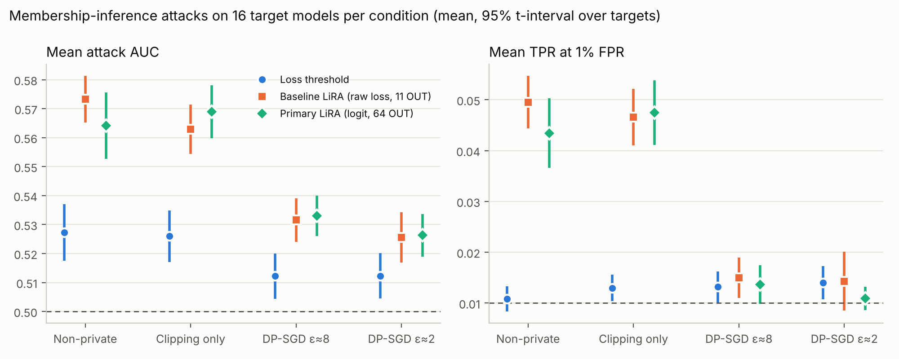
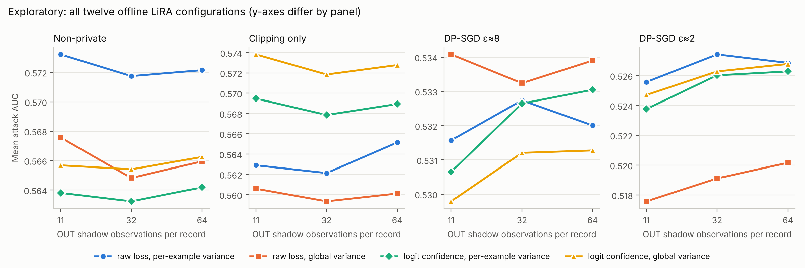

# Real-data LiRA validation — generated results

Generated by `research/lira_validation_report.py` from `summary.csv`, `per_target.csv` and `results.json` in this directory. Protocol: `docs/LIRA_VALIDATION_PROTOCOL.md`. Protocol hash `326d8849cbb7dd7952975d7c42deed711c32a77226e26c83cac7c66d3797b4f1`. Data SHA-256 `388eff679557d08ac19f463d025de5e0b4adc482537c8456d19934d78621fd47`.

Runtime: {"python": "3.13.16", "platform": "Linux-6.18.44-fc-v470-x86_64-with-glibc2.39", "numpy": "2.5.4", "torch": "2.14.1+cpu", "opacus": "1.6.0", "scikit-learn": "1.9.1", "pandas": "3.0.6", "scipy": "1.18.1"}

Each target has 669 members and 669 non-members; n = 16 targets per condition. Intervals are 95% t-intervals over targets. A non-detection is not evidence of privacy.

## Conditions and accounting

| Condition | Noise multiplier | Sample rate | Steps | Achieved ε (δ=1e-5) | Train acc. | Held-out acc. |
|---|---|---|---|---|---|---|
| Non-private | none | n/a (shuffled) | 4400 | none | 0.991 | 0.901 |
| Clipping only | 0.0 | 0.0909 | 4400 | none | 0.984 | 0.906 |
| DP-SGD ε≈8 | 3.9306640625 | 0.0909 | 4400 | 7.9954 | 0.923 | 0.922 |
| DP-SGD ε≈2 | 13.046875 | 0.0909 | 4400 | 1.9929 | 0.852 | 0.842 |

## Predeclared attacks

| Condition | Attack | Mean AUC [95% CI] | Mean TPR at 1% FPR [95% CI] | Detection p (Holm) | Mismatched-label control AUC |
|---|---|---|---|---|---|
| Non-private | Loss threshold | 0.5272 [0.5175, 0.5370] | 0.0108 [0.0083, 0.0133] | 2.7e-12 (unadjusted) | 0.5006 |
| Non-private | Baseline LiRA | 0.5732 [0.5652, 0.5813] | 0.0495 [0.0444, 0.0547] | 1.7e-76 | 0.4980 |
| Non-private | Primary LiRA | 0.5642 [0.5527, 0.5756] | 0.0434 [0.0366, 0.0503] | 2.9e-59 | 0.4931 |
| Clipping only | Loss threshold | 0.5260 [0.5171, 0.5348] | 0.0130 [0.0104, 0.0156] | 2.3e-11 (unadjusted) | 0.5017 |
| Clipping only | Baseline LiRA | 0.5629 [0.5544, 0.5714] | 0.0466 [0.0411, 0.0522] | 5.5e-57 | 0.4998 |
| Clipping only | Primary LiRA | 0.5689 [0.5598, 0.5780] | 0.0475 [0.0411, 0.0538] | 5.4e-68 | 0.4998 |
| DP-SGD ε≈8 | Loss threshold | 0.5122 [0.5044, 0.5200] | 0.0132 [0.0101, 0.0162] | 0.0010 (unadjusted) | 0.5076 |
| DP-SGD ε≈8 | Baseline LiRA | 0.5316 [0.5241, 0.5391] | 0.0149 [0.0110, 0.0189] | 1.3e-15 | 0.4994 |
| DP-SGD ε≈8 | Primary LiRA | 0.5330 [0.5261, 0.5400] | 0.0136 [0.0098, 0.0174] | 5.7e-17 | 0.4997 |
| DP-SGD ε≈2 | Loss threshold | 0.5123 [0.5045, 0.5201] | 0.0140 [0.0108, 0.0173] | 9.3e-04 (unadjusted) | 0.5068 |
| DP-SGD ε≈2 | Baseline LiRA | 0.5256 [0.5169, 0.5343] | 0.0143 [0.0085, 0.0201] | 4.6e-11 | 0.5028 |
| DP-SGD ε≈2 | Primary LiRA | 0.5263 [0.5189, 0.5337] | 0.0109 [0.0086, 0.0132] | 1.4e-11 | 0.5040 |

## Primary minus baseline, paired by target

| Condition | Metric | Mean difference [95% CI] | Sign-flip p | Targets improved |
|---|---|---|---|---|
| Non-private | AUC | -0.0090 [-0.0201, +0.0020] | 0.1028 | 5/16 |
| Non-private | TPR at 1% FPR | -0.0061 [-0.0124, +0.0003] | 0.0651 | 4/16 |
| Clipping only | AUC | +0.0060 [-0.0026, +0.0147] | 0.1570 | 11/16 |
| Clipping only | TPR at 1% FPR | +0.0008 [-0.0058, +0.0075] | 0.8127 | 8/16 |
| DP-SGD ε≈8 | AUC **(primary endpoint)** | +0.0015 [-0.0022, +0.0052] | 0.3755 | 11/16 |
| DP-SGD ε≈8 | TPR at 1% FPR | -0.0013 [-0.0044, +0.0018] | 0.4238 | 8/16 |
| DP-SGD ε≈2 | AUC | +0.0007 [-0.0026, +0.0040] | 0.6579 | 9/16 |
| DP-SGD ε≈2 | TPR at 1% FPR | -0.0034 [-0.0090, +0.0022] | 0.2386 | 6/16 |

## Exploratory: all configurations (mean AUC / mean TPR at 1% FPR)

| Configuration | Non-private | Clipping only | DP-SGD ε≈8 | DP-SGD ε≈2 |
|---|---|---|---|---|
| `loss-threshold` | 0.5272 / 0.0108 | 0.5260 / 0.0130 | 0.5122 / 0.0132 | 0.5123 / 0.0140 |
| `raw_loss|per_example|K=22` | 0.5732 / 0.0495 | 0.5629 / 0.0466 | 0.5316 / 0.0149 | 0.5256 / 0.0143 |
| `raw_loss|global|K=22` | 0.5676 / 0.0413 | 0.5606 / 0.0414 | 0.5341 / 0.0158 | 0.5176 / 0.0114 |
| `logit_confidence|per_example|K=22` | 0.5638 / 0.0369 | 0.5695 / 0.0350 | 0.5307 / 0.0148 | 0.5238 / 0.0118 |
| `logit_confidence|global|K=22` | 0.5657 / 0.0368 | 0.5738 / 0.0418 | 0.5298 / 0.0144 | 0.5247 / 0.0104 |
| `raw_loss|per_example|K=64` | 0.5717 / 0.0494 | 0.5621 / 0.0515 | 0.5327 / 0.0149 | 0.5274 / 0.0142 |
| `raw_loss|global|K=64` | 0.5648 / 0.0427 | 0.5593 / 0.0438 | 0.5332 / 0.0158 | 0.5191 / 0.0107 |
| `logit_confidence|per_example|K=64` | 0.5632 / 0.0435 | 0.5679 / 0.0454 | 0.5326 / 0.0149 | 0.5260 / 0.0133 |
| `logit_confidence|global|K=64` | 0.5654 / 0.0429 | 0.5718 / 0.0470 | 0.5312 / 0.0140 | 0.5263 / 0.0118 |
| `raw_loss|per_example|K=128` | 0.5722 / 0.0513 | 0.5651 / 0.0518 | 0.5320 / 0.0162 | 0.5269 / 0.0133 |
| `raw_loss|global|K=128` | 0.5660 / 0.0432 | 0.5601 / 0.0447 | 0.5339 / 0.0159 | 0.5202 / 0.0125 |
| `logit_confidence|per_example|K=128` | 0.5642 / 0.0434 | 0.5689 / 0.0475 | 0.5330 / 0.0136 | 0.5263 / 0.0109 |
| `logit_confidence|global|K=128` | 0.5663 / 0.0422 | 0.5728 / 0.0474 | 0.5313 / 0.0127 | 0.5268 / 0.0094 |

## Exploratory diagnostics

| Condition | Saturated target losses | OUT-sd ratio p90/p10 (logit) | Non-member z mean / sd | |z|>3 | Mean TPR at 0.1% FPR, primary (descriptive) |
|---|---|---|---|---|---|
| Non-private | 0.4290 | 9919759572911.98 | -0.009 / 0.865 | 0.0061 | 0.0206 |
| Clipping only | 0.5502 | 11294293743862.36 | 0.001 / 0.879 | 0.0064 | 0.0266 |
| DP-SGD ε≈8 | 0.0000 | 2.09 | -0.019 / 1.013 | 0.0021 | 0.0011 |
| DP-SGD ε≈2 | 0.0000 | 1.66 | 0.132 / 0.946 | 0.0024 | 0.0019 |

Under a correct Gaussian OUT model the non-member z has mean 0, sd about 1 and |z|>3 about 0.003. TPR at 0.1% FPR allows zero false positives among 669 non-members and is descriptive only.

